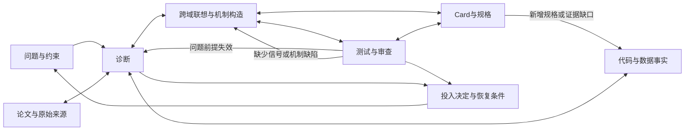

# Open Scientist · Codex / Claude Code 插件 v0.1

将 ResearchStudio 的证据、机制构造与反例检查，Research Companion 的选题、跨域联想与投入判断，以及 Co-Scientist 的假设审查、演化与证据关系组织在同一套研究记录上。

默认先做**能改变当前决定的最小行动**。不要求每次跑完整阶段、不强制多模型面板、不用 Card 长度或 Elo 代表研究质量。技能正文详细，方法与46张模式卡按需阅读。

## 先用起来

同一目录同时是 Codex 插件和 Claude Code 插件，技能正文与 MCP 记录层共用。安装后调用总入口：

| 宿主 | 调用方式 |
|---|---|
| Codex | `$open-scientist:research-workflow` |
| Claude Code | `/open-scientist:research-workflow`，或直接描述任务让技能自动触发 |

```text
用 research-workflow 检查这个研究项目。
先读现有代码和失败样例，确定问题是否真实，再用本机论文库与 arXiv 补证据。
不要默认开始训练；给出有区分力的下一步。
```

**自动模式**：给出交付目标和授权范围，总入口会持续推进到里程碑，而不是每做完一步就交回：

```text
/open-scientist:research-workflow 自动研究这个问题，记录写到当前项目。
目标：交付一个经过文献、代码和反例检查的研究方案，含方法 Card、关键风险和最小判别实验。
允许检索、读代码、运行廉价本地探测；不启动训练。一般缺口自行补齐，
直到达到目标、无法取得有效进展，或需要我决定实质方向。
```

每个动作写一个 `workflow` 检查点：目标、验收项、预算、已做动作、待解决问题、下一动作。`workflow_check` 逐项核对验收项，未通过时后端拒绝写 done。重复的动作键会被拒绝，预算不能超过上限，中断后从检查点继续。协议见 [auto-loop](references/contracts/auto-loop.md)。Claude Code 中，GRILL 阶段可以调用自带的 `research-grill` 子 Agent，从召回、对手审查、对抗攻击三个视角做独立审查。

已有明确任务可以直接调用 `research-retrieve`、`research-code`、`research-review` 等，不必绕回总入口。插件命名空间以宿主显示的 `open-scientist:...` 为准。

Claude Code 可直接从 GitHub 安装：`claude plugin marketplace add CrepuscularIRIS/open-scientist`，再 `claude plugin install open-scientist@open-scientist-local`。完整安装步骤见 [安装与验证](docs/install.md)。这是本地插件源码包；没有自动更改你的全局插件配置、发布到公共目录或替换三个原仓库。

## 十一个入口

| Skill | 解决什么问题 | 常见交回产物 |
|---|---|---|
| [research-workflow](skills/research-workflow/SKILL.md) | 开始、恢复与选择下一研究行动 | 当前问题/证据/未知/下一动作 |
| [research-retrieve](skills/research-retrieve/SKILL.md) | 本机论文库＋arXiv、全文阅读、增量查证 | 查询覆盖、原文、主张对应关系 |
| [research-diagnose](skills/research-diagnose/SKILL.md) | 瓶颈是否真实、哪项前提失效 | 失败条件、替代解释与问题版本 |
| [research-ideate](skills/research-ideate/SKILL.md) | 跨领域机制、前提挑战、新方向 | 有操作映射和断点的候选 |
| [research-construct](skills/research-construct/SKILL.md) | 将候选写成可查、可试的机制 | 观测模型、步骤、主张与预测 |
| [research-code](skills/research-code/SKILL.md) | 代码、数据、评测与环境是否支持前提 | 实际调用链与信息可用性 |
| [research-test](skills/research-test/SKILL.md) | 最小判别实验与执行反例 | 计划、运行材料、结果分类 |
| [research-review](skills/research-review/SKILL.md) | 机制、查新、来源、反例与修订审查 | 有对象和证据的 finding |
| [research-evolve](skills/research-evolve/SKILL.md) | 按具体缺陷组合、简化、改测试或重构 | Q/H/T 的明确变化与局部重检 |
| [research-report](skills/research-report/SKILL.md) | Card、规格、质量诊断与项目汇总 | 同一版本的可读视图 |
| [research-decide](skills/research-decide/SKILL.md) | 继续、修改、搁置、停止及重访 | 投入决定、理由、下一观察 |

## 交互比阶段更重要



[32条桥接目录](references/contracts/bridges.md) 给出每次调用的时机、输入、回流与停止条件。Companion 不只反哺 Phase0；代码发现、反例、可行性、Card与反馈都能重新定向某一局部工作。

## 详细内容怎样保留

- **技能层**：入口触发、输入、具体推理步骤、输出、分支、停止条件与案例。
- **方法层**：[methods](docs/skill-map.md) 保留并适配 RS 的长提示词、Companion角色问法与 Co 的审查/演化方法。解除旧宿主路径、固定人数/阶段/预算和不合理门禁。
- **模式资产**：[15主模式＋31子模式](references/patterns/INDEX.md) 完整保留原文，按触发问题和用途索引。允许零张或一张，不强制组合，不把历史录用教训当普适定律。
- **保真归档**：[vendor](vendor/README.md) 保存110个原文件及其原始字节；[manifest](docs/source-manifest.json) 记录源commit、dirty状态、SHA-256与许可。归档指令不直接执行。

用户可选 [方向](references/templates/direction-card.md)、[构造](references/templates/construction-card.md)、[挑战](references/templates/challenge-card.md)、[执行](references/templates/execution-card.md)、[决定](references/templates/decision-card.md) 视图；无需每次生成五份。Card 不是另一套科研事实库。

## 共享记录与工具

五类记录是 project、candidate、material、activity、assessment。问题 Q、机制 H、测试 T 各自可以改变；旧结果与反证保留。通过6个本地MCP工具（5个记录工具加 `workflow_check`）或同一CLI访问，见 [记录API](docs/record-api.md)。

MCP只做保存、读取、版本、上下文和验收检查，不启动训练、调用模型或调度后台研究；自动模式的循环由宿主 Agent 执行。宿主 Agent 负责实际读代码、查来源、执行获授权的测试并解释结果。它不自动保证“写入的主张为真”，也不自动生成盲审上下文。

检索使用只读SQLite FTS5及arXiv公开关键词接口，见 [检索说明](docs/search-adapter.md)。不复制论文库、不自动建索引、不需要Semantic Scholar/OpenAlex密钥。两源状态分别保存；本地空结果和远端不可达不能变成“新颖性高”。

## 验证与局限

[验证记录](docs/validation.md) 区分资产保真、代码测试、真实MCP通信、本机检索、合成桥接演示和文本场景检查。它们不等于已证明科研产出质量提升。

本版不迁入Co常驻supervisor/Elo/向量聚类，不迁入RS固定阶段控制器，也不把Reel海报视频生产放进科研默认路径。后续是否需要这些功能，应由真实使用收益决定。

## 许可

新增胶水代码和文档使用 [MIT](LICENSE)。ResearchStudio、Research Companion 原资产保留各自MIT版权文本，Co-Scientist原资产与派生内容保留Apache-2.0义务，见 [第三方声明](THIRD_PARTY_NOTICES.md)。原论文内容与数据库没有随包分发。
